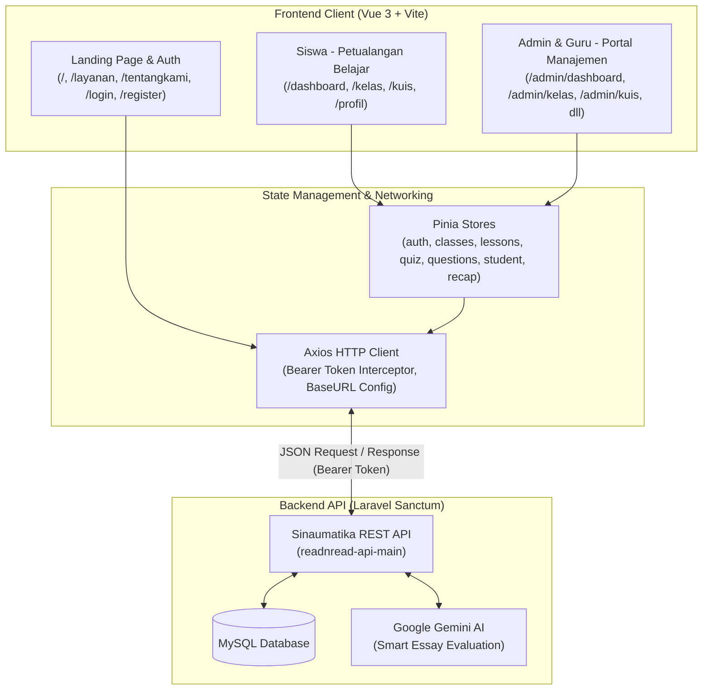
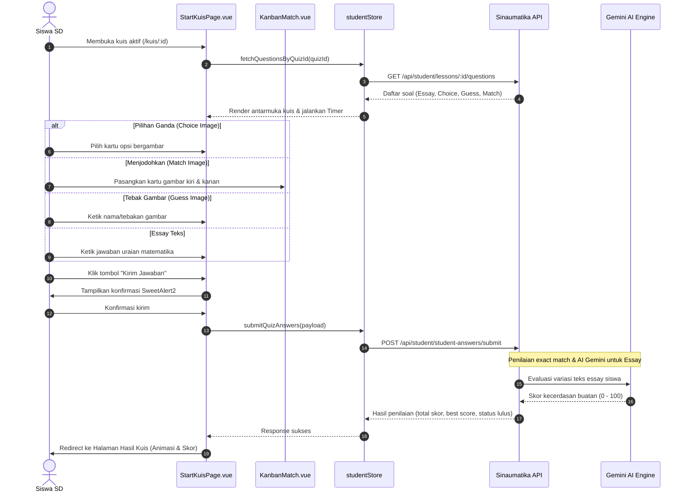

# Frontend Sinau Matika — Dokumentasi Sistem

## 1. Tentang Sinau Matika Frontend

**Sinau Matika Frontend** adalah antarmuka web interaktif dari platform *Learning Management System* (LMS) gamifikasi pembelajaran matematika Sekolah Dasar (SD). Aplikasi ini bertindak sebagai klien utama yang mengonsumsi layanan RESTful API dari backend **Sinaumatika API** (`readnread-api-main`).

Nama "Sinau Matika" diambil dari kombinasi kata **"sinau"** (belajar dalam Bahasa Jawa) dan **"matematika"**, dengan misi menghadirkan pengalaman belajar matematika yang menyenangkan, mudah dipahami, tidak menakutkan bagi anak-anak usia SD, serta terintegrasi dengan teknologi kecerdasan buatan (*AI grading*) untuk evaluasi kuis otomatis.

Aplikasi frontend ini dirancang dengan segmentasi antarmuka khusus sesuai peran (*role*):
1. **Publik & Calon Pengguna**: Landing page informatif, form pendaftaran akun, dan login.
2. **Siswa SD**: Antarmuka ramah anak bertema *"Petualangan Belajar"* yang penuh warna ceria, ilustrasi menarik, navigasi sederhana, dan pengerjaan kuis interaktif (4 variasi tipe soal).
3. **Guru**: Dashboard pengajar, manajemen materi, manajemen kelas, monitoring hasil kuis, rekap nilai per semester, serta hak eksklusif dalam mengaktivasi atau menonaktifkan kuis.
4. **Admin**: Bertindak sebagai **peran pembantu guru** untuk manajemen dan input data master (sekolah, kelas, siswa, guru, materi, kuis, soal) dengan batasan operasional tertentu.

---

## 2. Arsitektur & Hubungan Sistem

Aplikasi frontend berkomunikasi secara *asynchronous* dengan backend Laravel melalui protokol HTTP/REST API dengan pertukaran format data JSON dan token otentikasi Bearer (Laravel Sanctum).



---

## 3. Teknologi yang Digunakan

| Komponen / Library | Versi | Fungsi & Peran dalam Sistem |
|--------------------|-------|-----------------------------|
| **Vue.js** | `^3.5.13` | Framework JavaScript progresif inti, menggunakan **Composition API** (`<script setup>`) untuk modularitas logika dan reaktivitas data. |
| **Vite** | `^6.3.5` | Tooling & bundler build modern dengan HMR (*Hot Module Replacement*) ultra cepat. |
| **Vue Router** | `^4.5.1` | Router SPA resmi untuk navigasi halaman, *nested routes*, dan pengamanan rute (*navigation guards*). |
| **Pinia** | `^3.0.2` | Pengelola state terpusat (*state management*) yang ringan dan reaktif untuk seluruh modul aplikasi. |
| **Tailwind CSS** | `^4.1.7` | Framework CSS utility-first untuk tata letak modern, responsif, dan styling cepat. |
| **DaisyUI** | `^5.0.35` | Pustaka komponen UI berbasis Tailwind CSS (Buttons, Modals, Cards, Alerts, Badges, Tabs, Drawer). |
| **Axios** | `^1.9.0` | HTTP Client berbasis Promise untuk komunikasi API dengan konfigurasi interceptor otomatis. |
| **Vue3-Lottie** | `^3.3.1` | Komponen visual rendering animasi Lottie (JSON) untuk mempercantik landing page dan dashboard gamifikasi anak. |
| **SweetAlert2** | `^11.6.13` | Modal dialog, notifikasi popup, dan konfirmasi aksi (seperti konfirmasi kirim kuis atau hapus data). |
| **@vueup/vue-quill**| `^1.2.0` | Rich text WYSIWYG editor untuk pembuatan konten teks materi pelajaran yang kaya format. |
| **XLSX (SheetJS)** | `^0.18.5` | Library untuk membaca dan mengekspor matriks rekapitulasi nilai siswa ke berkas spreadsheet Microsoft Excel (`.xlsx`). |
| **Dayjs** | `^1.11.13` | Utilitas manipulasi, parsing, dan formatting tanggal/waktu (mendukung locale Bahasa Indonesia). |
| **Heroicons & FontAwesome** | `^2.2.0` / `^6.7.2` | Kumpulan icon vektor untuk elemen antarmuka, tombol aksi, dan navigasi ramah anak. |

---

## 4. Struktur Direktori Proyek

```
lms-gamifikasi-main/
├── public/                 # Aset statis publik (ikon, gambar SVG/PNG)
├── src/
│   ├── api/                # Layer pemanggilan HTTP API (Axios endpoints)
│   │   ├── authApi.js           # Endpoint login, register, logout
│   │   ├── axiosInstance.js     # Instance Axios terkonfigurasi token & base URL
│   │   ├── classesApi.js        # Endpoint CRUD kelas
│   │   ├── dashboardApi.js      # Endpoint statistik dashboard
│   │   ├── lessonsApi.js        # Endpoint CRUD pelajaran & upload thumbnail
│   │   ├── studentRecapApi.js   # Endpoint rekap nilai siswa
│   │   ├── studentsClassesApi.js# Endpoint penempatan siswa ke kelas
│   │   ├── teacherApi.js        # Endpoint guru
│   │   ├── userApi.js           # Endpoint CRUD pengguna & profil
│   │   ├── quiz/                # Endpoint kuis, bank soal, dan opsi
│   │   └── users/               # Endpoint data guru, siswa, alumni
│   ├── assets/             # Gambar lokal, logo sekolah, gaya CSS utama
│   ├── components/         # Komponen UI Vue yang dapat digunakan ulang
│   │   ├── KanbanMatch.vue      # Komponen interaktif kuis menjodohkan gambar (Match Image)
│   │   ├── admin/layouts/       # Navbar, Sidebar, Footer antarmuka Admin & Guru
│   │   ├── landing/             # Navbar, Footer antarmuka publik
│   │   └── student/             # Navbar, Sidebar, MobileNav, SubNav antarmuka Siswa
│   ├── docs/               # Berkas dokumentasi frontend sistem
│   │   ├── FeSinaumatika.md     # Arsitektur sistem & panduan umum (berkas ini)
│   │   ├── admin.md             # Dokumentasi fitur Admin & batasan hak kuis
│   │   ├── guru.md              # Dokumentasi fitur Guru & hak aktivasi kuis
│   │   ├── siswa.md             # Dokumentasi fitur Siswa & kuis interaktif
│   │   └── landing_page.md      # Dokumentasi Landing Page & Autentikasi
│   ├── helper/             # Fungsi utilitas (format tanggal, parser, validator)
│   ├── pages/              # Halaman tampilan utama aplikasi
│   │   ├── NotFoundPage.vue     # Tampilan halaman 404
│   │   ├── admin/               # Halaman portal Admin & Guru (kelas, pelajaran, user, kuis)
│   │   ├── Auth/                # Halaman Login dan Register
│   │   ├── Landing/             # Halaman Beranda publik, Layanan, Tentang Kami
│   │   └── student/             # Halaman Siswa (Dashboard, Kelasku, Detail Pelajaran, Kuis)
│   ├── router/             # Konfigurasi rute Vue Router & Guards
│   │   ├── index.js             # Integrasi rute utama dan global router guards
│   │   ├── public.routes.js     # Definisi rute landing page & autentikasi
│   │   ├── admin.routes.js      # Definisi rute portal admin & guru
│   │   └── student.routes.js    # Definisi rute portal siswa
│   ├── store/              # State management Pinia
│   │   ├── authStore.js         # State kredensial, role pengguna, status login
│   │   ├── classesStore.js      # State data rombongan belajar kelas
│   │   ├── lessonsStore.js      # State materi & pelajaran
│   │   ├── quizStore.js         # State kuis dan riwayat pengerjaan
│   │   ├── QuestionsStore.js    # State bank soal (4 tipe)
│   │   ├── studentStore.js      # State kuis aktif dan jawaban kuis siswa
│   │   ├── studentRecapStore.js # State matriks rekap nilai kelas 1-6
│   │   └── userStore.js         # State data pengguna
│   ├── App.vue             # Komponen root aplikasi Vue
│   └── main.js             # Entrypoint inisialisasi aplikasi, plugin, & styles
├── index.html              # Template HTML dasar
├── package.json            # Daftar dependensi & npm scripts
└── vite.config.js          # Konfigurasi bundler Vite & plugin Vue
```

---

## 5. Alur Otentikasi & Otorisasi Pengguna

Sistem menerapkan pengamanan rute berbasis peran (*Role-Based Access Control / RBAC*) yang dievaluasi pada saat navigasi rute (`router.beforeEach`).

### Diagram Alur Akses Halaman

```mermaid
flowchart TD
    StartNav([Pengguna Membuka URL]) --> CheckPublic{Apakah Halaman Publik?\n(meta.publicPage)}
    
    CheckPublic -- Ya --> AllowPublic[Izinkan Akses Halaman]
    CheckPublic -- Tidak --> CheckAuth{Apakah Memiliki Token?\n(localStorage: token)}
    
    CheckAuth -- Tidak --> RedirectLogin[Redirect ke /login]
    CheckAuth -- Ya --> CheckGuest{Apakah Halaman Khusus Tamu?\n(meta.guest)}
    
    CheckGuest -- Ya --> RoleRedirect{Periksa Role}
    RoleRedirect -- "admin" atau "guru" --> RedirectAdminPortal[Redirect ke /admin]
    RoleRedirect -- "siswa" --> RedirectStudentDashboard[Redirect ke /dashboard]
    
    CheckGuest -- Tidak --> CheckAdminOnly{Apakah Rute Khusus Admin?\n(guardAdminOnly)}
    CheckAdminOnly -- "Ya & Role = guru" --> RedirectTeacherDash[Redirect ke /admin/dashboard/teacher]
    CheckAdminOnly -- Lainnya --> AllowRoute[Izinkan Akses Halaman Sesuai Role]
```

### Matriks Hak Akses Antarmuka

| Kategori Halaman | Siswa | Guru | Admin | Tamu / Publik |
|------------------|:-----:|:----:|:-----:|:-------------:|
| Landing Page (`/`, `/layanan`, `/tentangkami`) | ✅ | ✅ | ✅ | ✅ |
| Login & Register (`/login`, `/register`) | Redirect ke Dash | Redirect ke Admin | Redirect ke Admin | ✅ |
| Portal Siswa (`/dashboard`, `/kelas`, `/kuis`) | ✅ | ❌ | ❌ | Redirect Login |
| Pengerjaan Kuis Siswa (`/kuis/:id`) | ✅ | ❌ | ❌ | Redirect Login |
| Dashboard Portal Manajemen (`/admin/dashboard/*`) | ❌ | ✅ (Teacher) | ✅ (Admin) | Redirect Login |
| Manajemen Data Guru & Alumni | ❌ | ❌ | ✅ | Redirect Login |
| Manajemen Kelas & Pelajaran | ❌ | ✅ (Kelas Binaan) | ✅ (Semua Kelas) | Redirect Login |
| Input Data Kuis & Soal | ❌ | ✅ | ✅ (Pembantu Input) | Redirect Login |
| **Aktivasi Status Kuis (`is_active = true/false`)** | ❌ | **✅ (Hanya Guru)** | **❌ (Dinonaktifkan)** | ❌ |
| Rekap Nilai Siswa (`/admin/rekap-nilai`) | ❌ | ✅ (Kelas Binaan) | ✅ (Semua Kelas) | Redirect Login |

---

## 6. Alur Pengerjaan Kuis & Penilaian Interaktif

Sistem kuis pada frontend mendukung 4 variasi tipe soal matematika interaktif:



---

## 7. Penanganan Error & Pengalaman Pengguna (UX)

1. **SweetAlert2 Feedback**: Setiap aksi penting (login berhasil/gagal, simpan materi, submit kuis, konfirmasi logout) disertai modal dialog informatif dengan teks dan ikon yang ramah bagi pengguna.
2. **Animasi Lottie**: Menghadirkan atmosfer gamifikasi ceria untuk menjaga antusiasme siswa SD saat belajar matematika.
3. **Peringatan Hak Akses (*Visual Cue*)**: Pada halaman formulir kuis admin, toggle pengaktifan kuis terkunci dengan label indikator berwarna kuning/amber:
   > ⚠️ *Status aktif kuis hanya dapat diubah oleh Guru dari kelas yang bersangkutan.*
4. **Desain Responsif**: Antarmuka dioptimalkan untuk perangkat mobile/tablet melalui *drawer sidebar* dan tata letak fleksibel Tailwind CSS.

