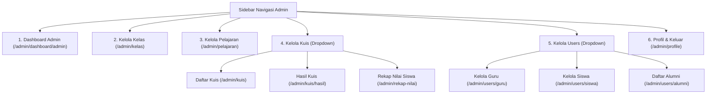

# Dokumentasi Frontend — Modul Admin

## 1. Ikhtisar Peran Admin

Dalam sistem **Sinau Matika**, peran **Admin** dirancang secara spesifik sebagai **peran pembantu guru dalam tata kelola dan input data master**. Admin memiliki akses luas untuk mempermudah operasional sekolah dalam mendaftarkan entitas pengguna, kelas rombel, pelajaran, hingga bank soal.

> [!IMPORTANT]
> **Batasan Hak Akses Utama Admin (Status Kuis):**
> Meskipun Admin bertugas membantu penginputan kuis dan bank soal, **Admin TIDAK BISA mengubah status aktif kuis (`is_active`)**.
> Hak untuk mengaktifkan atau menonaktifkan kuis adalah **hak eksklusif Guru** pengampu kelas terkait. Hal ini memastikan pelaksanaan kuis/ujian sepenuhnya berada di bawah kendali pedagogis guru kelas.

---

## 2. Struktur Menu & Navigasi Admin

Pada antarmuka portal manajemen (`AppSidebar.vue`), menu admin disusun sebagai berikut:

---

## 3. Fitur-Fitur Modul Admin

### 3.1. Dashboard Admin (`DashboardAdmin.vue`)

Halaman ringkasan eksekutif yang menyajikan statistik keseluruhan sistem secara _real-time_:

- **Statistik Global**:
  - Jumlah total kelas rombel aktif
  - Jumlah total guru terdaftar
  - Jumlah total siswa aktif
  - Jumlah total alumni (siswa lulus)
  - Jumlah total modul pelajaran matematika
  - Jumlah total kuis yang terdaftar di sistem
- **Widget Aktivitas Terkini**: Tabel ringkas pemantauan kuis terbaru dan status pengerjaan oleh siswa.

---

### 3.2. Manajemen Pengguna (User Management)

Admin memiliki wewenang penuh dalam mengelola kredensial dan status akun civitas sekolah:

#### a. Kelola Guru (`ListGuruPage.vue`)

- **Daftar Guru**: Menampilkan data guru beserta NIP/email, status akun, dan aksi manajemen.
- **Tambah Guru (`AddGuruPage.vue`)**: Mendaftarkan guru baru dengan nama lengkap, email, password awal, nomor kontak, dan jenis kelamin.
- **Detail Guru (`DetailGuruPage.vue`)**: Menampilkan identitas guru, kelas-kelas yang diampu, serta daftar pelajaran yang diasuh.
- **Ubah Profil Guru (`EditGuruProfilePage.vue`)**: Mengubah biodata dan kontak guru.
- **Ubah/Reset Password Guru (`EditGuruPasswordPage.vue`)**: Mengatur ulang kata sandi guru jika lupa password.
- **Hapus Akun Guru**: Menghapus atau menonaktifkan akun pendidik.

#### b. Kelola Siswa (`ListSiswaPage.vue`)

- **Daftar Siswa Aktif**: Tabel pencarian dan pemfilteran siswa berdasarkan nama, NISN, atau kelas.
- **Tambah Siswa (`AddSiswaPage.vue`)**: Pendaftaran siswa baru untuk rombongan belajar.
- **Detail Siswa (`DetailUserPage.vue`)**: Riwayat akademik, kelas yang ditempati, dan riwayat pengerjaan kuis.
- **Ubah Profil Siswa (`EditSiswaProfilePage.vue`)**: Pembaruan biodata siswa.
- **Ubah Password Siswa (`EditSiswaPasswordPage.vue`)**: Penggantian kata sandi akun siswa.
- **Status Kelulusan Siswa**: Memperbarui status siswa menjadi `lulus` sehingga otomatis dipindahkan ke daftar alumni.

#### c. Daftar Alumni (`ListAlumniPage.vue`)

- Menampilkan arsip data siswa yang telah berstatus `lulus`.
- Memungkinkan penelusuran riwayat nilai historis siswa terdahulu tanpa mengacaukan rombel kelas aktif.

---

### 3.3. Manajemen Kelas (`ClassesPage.vue`)

Mengatur rombongan belajar (rombel) matematika setiap tahun ajaran:

- **Daftar Kelas**: Menampilkan nama kelas, jenjang (Kelas 1 s.d. Kelas 6), semester (Gasal/Genap), tahun ajaran (misal: `2025/2026`), dan nama guru wali/pengampu.
- **Tambah Kelas (`AddClassPage.vue`)**: Form pembuatan rombel baru (hanya dapat dibuat oleh Admin melalui route guard `guardAdminOnly`).
- **Edit Kelas (`EditClassPage.vue`)**: Memperbarui nama rombel, tahun akademik, atau menugaskan guru pengampu baru.
- **Detail Kelas (`DetailClassesPage.vue`)**: Rincian materi pelajaran dan daftar siswa dalam kelas.
- **Kelola Siswa Kelas (`ClassStudentsPage.vue`)**:
  - Menambahkan siswa aktif yang belum memiliki rombel ke dalam kelas ini.
  - Mengeluarkan siswa dari kelas (memungkinkan siswa dipindahkan ke rombel lain).
  - _Catatan Bisnis_: Setiap siswa hanya dapat terdaftar pada satu rombel aktif.

---

### 3.4. Manajemen Pelajaran (`LessonsPage.vue`)

Admin membantu guru dalam mendigitalkan materi kurikulum matematika:

- **Daftar Pelajaran**: Menampilkan seluruh materi ajar, kelas target, serta thumbnail visual.
- **Tambah Pelajaran (`AddLessonPage.vue`)**:
  - Menginput judul bab/materi, deskripsi ringkas, dan kelas tujuan.
  - Upload berkas thumbnail gambar pelajaran (JPG/PNG).
  - Penulisan isi materi menggunakan **Rich Text Editor (Vue-Quill)** dengan dukungan pemformatan teks tebal, miring, poin, dan rumus matematika dasar.
- **Edit Pelajaran (`EditLessonsPage.vue`)**: Memperbarui teks bacaan atau gambar pendukung materi.
- **Detail Pelajaran (`DetailLessonsPage.vue` & `AdminDetailQuizPage.vue`)**: Memeriksa tampilan materi dan daftar kuis yang terasosiasi ke pelajaran tersebut.

---

### 3.5. Manajemen Kuis & Bank Soal (Peran Pembantu Guru)

Admin bertugas meringankan beban teknis guru dalam menginput kuis dan ratusan butir soal latihan.

#### a. Input Kuis Baru & Sunting Kuis

- Halaman: `AddQuizPage.vue` dan `EditQuizPage.vue`.
- Input field: Judul kuis, deskripsi instruksi, durasi pengerjaan (menit), waktu mulai (_start time_), waktu selesai (_end time_), serta memilih pelajaran terkait.
- **Aturan Status Kuis (`is_active`):**
  - Pada halaman ini, komponen toggle `is_active` dibuat dalam kondisi **`disabled`** jika pengguna login memiliki peran `admin`.
  - Terdapat pesan peringatan visual:
    > ⚠️ _Status aktif kuis hanya dapat diubah oleh Guru dari kelas yang bersangkutan._
  - Nilai `is_active` otomatis default ke `0` (Tidak Aktif) ketika kuis dibuat oleh admin, menunggu validasi dan aktivasi oleh Guru.

#### b. Input Butir Pertanyaan (4 Tipe Soal)

Halaman: `AddQuestionsPage.vue`, `EditQuestionsPage.vue`, `DetailQuizPage.vue`.
Admin dapat membantu menginput 4 variasi tipe soal gamifikasi:

| Tipe Soal        | Komponen Antarmuka Form                                                                                                 | Keterangan Data yang Diinput                                                                          |
| ---------------- | ----------------------------------------------------------------------------------------------------------------------- | ----------------------------------------------------------------------------------------------------- |
| **Essay**        | Textarea deskripsi soal, gambar ilustrasi (opsional), daftar kunci jawaban benar (dipisahkan baris atau karakter `\|`). | Siswa akan menjawab teks bebas, dinilai otomatis oleh exact match atau AI Gemini.                     |
| **Choice Image** | Teks pertanyaan, upload gambar opsi A, B, C, D, dan radio button penentu opsi benar (`is_correct = true`).              | Siswa memilih salah satu kartu gambar opsi yang benar.                                                |
| **Guess Image**  | Teks petunjuk, upload gambar objek matematika yang harus ditebak, serta teks kunci jawaban tebakan.                     | Siswa menebak nama/istilah berdasarkan gambar yang ditampilkan.                                       |
| **Match Image**  | Upload gambar sisi kiri (_left item_) dan gambar pasangan sisi kanan (_right item_).                                    | Siswa akan menjodohkan kartu kiri dan kanan secara interaktif menggunakan komponen `KanbanMatch.vue`. |

---

### 3.6. Monitoring Hasil Kuis & Rekapitulasi Nilai

#### a. Hasil Pengerjaan Siswa (`ResultQuizPage.vue`)

- Menampilkan tabel riwayat pengerjaan kuis siswa dari seluruh kelas.
- Menyajikan status kelulusan (Lulus/Tidak Lulus berdasarkan KKM), skor perolehan, dan durasi pengerjaan.
- **Detail Hasil Kuis (`DetailQuizResultPage.vue` & `DetailUserQuiz.vue`)**:
  - Rekaman snapshot jawaban siswa pada masing-masing butir soal.
  - Tampilan skor hasil evaluasi Google Gemini AI untuk butir soal essay (termasuk feedback/alasan pemberian nilai).

#### b. Rekap Nilai Siswa (`StudentScoreRecapPage.vue`)

- **Tampilan Matriks Komprehensif**: Menampilkan rekapitulasi nilai rata-rata siswa dalam format kisi kelas 1 hingga kelas 6 (Semester Gasal dan Semester Genap — total 12 sel penilaian per siswa).
- **Filter Pencarian**: Memfilter data berdasarkan rombel kelas, nama siswa, atau status siswa.
- **Fitur Ekspor Spreadsheet**: Mengunduh tabel rekap nilai ke format berkas Excel (`.xlsx`) secara langsung menggunakan library `SheetJS (xlsx)`.

---

### 3.7. Profil Admin (`AdminProfilePage.vue`)

- Memperbarui nama dan email administrator.
- Melakukan pembaruan kata sandi akun admin.
- Tombol logout dengan dialog konfirmasi SweetAlert2.
