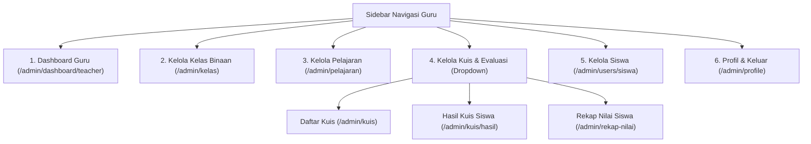

# Dokumentasi Frontend — Modul Guru

## 1. Ikhtisar Peran Guru

Dalam sistem **Sinau Matika**, peran **Guru** memegang kendali pedagogis penuh terhadap proses kegiatan belajar mengajar (KBM) matematika, perancangan materi, penyusunan kuis, evaluasi hasil belajar, serta penentuan waktu pelaksanaan asesmen bagi kelas-kelas yang diampunya.

Berbeda dengan peran Admin yang berkedudukan sebagai pembantu input data administratif, Guru memiliki hak istimewa operasional yang sangat krusial:

> [!IMPORTANT]
> **Hak Eksklusif Guru: Otoritas Aktivasi Kuis (`is_active`)**
> **Hanya Guru yang memiliki wewenang untuk mengubah status aktif kuis (`is_active = true/false`)**.
> - Kuis yang baru diinputkan (baik oleh admin maupun guru) tidak akan dapat diakses oleh siswa sebelum Guru kelas mengaktifkannya.
> - Guru mengaktifkan kuis ketika siswa siap mengerjakan ujian/latihan di kelas.
> - Guru dapat menonaktifkan kembali kuis tersebut segera setelah sesi ujian berakhir untuk mencegah kebocoran atau pengerjaan di luar jadwal.

---

## 2. Struktur Menu & Navigasi Guru

Pada antarmuka portal manajemen (`AppSidebar.vue`), menu untuk guru difokuskan pada kegiatan kurikuler dan penilaian:



> [!NOTE]
> Menu manajemen akun guru lain (`/admin/users/guru`), tambah kelas baru (`/admin/kelas/tambah`), dan daftar alumni (`/admin/users/alumni`) secara otomatis disembunyikan dari sidebar Guru dan dilindungi route guard `guardAdminOnly`.

---

## 3. Fitur-Fitur Utama Modul Guru

### 3.1. Dashboard Guru (`DashboardGuru.vue`)
Pusat informasi kegiatan mengajar yang terisolasi khusus untuk kelas yang diampu guru:
- **Kartu Ringkasan KBM**:
  - Jumlah kelas matematika yang diampu saat ini.
  - Total siswa aktif yang berada di bawah bimbingan guru.
  - Jumlah modul pelajaran yang telah dipublikasikan.
  - Jumlah kuis yang sedang dalam status **Aktif**.
- **Tabel Kuis Terjadwal**: Memantau jadwal pelaksanaan kuis terdekat, durasi, dan status keaktifan kuis.
- **Tinjauan Cepat Nilai Siswa**: Grafik atau rekap singkat rata-rata performa siswa pada kuis terkini.

---

### 3.2. Manajemen Kelas Binaan (`ClassesPage.vue`)
- **Daftar Kelas Binaan**: Guru dapat melihat rincian kelas tempat ia ditugaskan sebagai pengampu.
- **Detail Kelas (`DetailClassesPage.vue`)**:
  - Memeriksa daftar siswa yang terdaftar dalam rombongan belajar.
  - Melihat direktori modul pelajaran matematika yang telah ditugaskan ke kelas tersebut.
- **Kelola Siswa Kelas (`ClassStudentsPage.vue`)**: Memantau kehadiran siswa dalam rombel kelas dan mengelola daftar nama siswa yang terdaftar.

---

### 3.3. Manajemen Pelajaran & Materi Matematika (`LessonsPage.vue`)
Guru merancang konten kurikulum yang disesuaikan dengan tingkat kognitif siswa SD:
- **Tambah Pelajaran (`AddLessonPage.vue`)**:
  - Menentukan nama materi (contoh: *Pecahan Sederhana*, *Operasi Perkalian Bilangan Cacah*, *Bangun Datar*).
  - Mengunggah thumbnail gambar materi yang menarik perhatian anak-anak.
  - Menulis isi pembelajaran menggunakan **Rich Text Editor (Vue-Quill)**: menyisipkan format teks, daftar berpoin, warna penegas, dan gambar pendukung di dalam naskah penjelasan.
- **Edit & Perbarui Pelajaran (`EditLessonsPage.vue`)**: Memperbaiki isi materi atau menambah contoh soal latihan.
- **Integrasi dengan Kuis**: Melalui halaman detail pelajaran, guru dapat langsung menghubungkan kuis evaluasi ke pelajaran terkait.

---

### 3.4. Manajemen Kuis & Bank Soal (Dengan Hak Penuh Aktivasi)

#### a. Kontrol Status Keaktifan Kuis (`is_active`)
Pada antarmuka `AddQuizPage.vue` dan `EditQuizPage.vue`:
- Sistem mengevaluasi logika hak akses:
  ```javascript
  const canToggleActive = computed(() => {
    if (userRole.value !== 'guru') return false;
    // Guru kelas memiliki hak penuh untuk mengaktifkan
    return true;
  });
  ```
- **Toggle Saklar Status**: Guru dapat dengan bebas menggeser switch status:
  - **Aktif (Hijau)**: Kuis langsung muncul di halaman siswa (`/kuis`) dan siap dikerjakan.
  - **Tidak Aktif (Abu-abu)**: Kuis disembunyikan/dikunci dari siswa, cocok saat soal masih dirancang atau waktu ujian telah selesai.
- **Detail Kuis (`DetailQuizPage.vue`)**: Menampilkan indikator status jadwal (*Belum Dimulai*, *Sedang Berlangsung*, atau *Telah Berakhir*) yang berkombinasi dengan status keaktifan kuis.

#### b. Pembuatan Soal Interaktif (4 Tipe Soal)
Guru dapat merancang soal evaluasi matematika berbasis gamifikasi pada halaman `AddQuestionsPage.vue` dan `EditQuestionsPage.vue`:

1. **Soal Essay Teks**:
   - Guru mengetikkan pertanyaan cerita atau soal hitungan uraian.
   - Guru dapat memasukkan **multi kunci jawaban** yang dipisahkan dengan tanda pipa (`|`), misalnya: `15 apel|lima belas apel|15 buah apel`.
   - *Keunggulan AI*: Apabila siswa menjawab sedikit berbeda (misal ada typo ringan atau penulisan angka huruf), **Google Gemini AI** pada backend akan mengevaluasi jawaban secara cerdas dan memberikan nilai proporsional (*partial scoring*).
2. **Pilihan Ganda Gambar (Choice Image)**:
   - Guru mengunggah 4 pilihan kartu gambar (opsi A, B, C, D) yang mewakili bentuk geometri, jumlah benda, atau grafik bilangan.
   - Menandai satu opsi sebagai jawaban benar.
3. **Tebak Gambar (Guess Image)**:
   - Guru mengunggah satu gambar misteri (misal gambar sudut lancip atau bangun prisma).
   - Menentukan kunci jawaban teks yang harus ditebak siswa.
4. **Menjodohkan Gambar (Match Image)**:
   - Guru memasangkan pasangan gambar kiri dan kanan (misal gambar jam analog di kiri dipasangkan dengan kartu angka jam digital di kanan).
   - Komponen antarmuka siswa akan merender sistem kartu interaktif menjodohkan.

---

### 3.5. Evaluasi Hasil Kuis & Rekapitulasi Nilai Siswa

#### a. Pemantauan Hasil Kuis Siswa (`ResultQuizPage.vue`)
- Secara otomatis hanya menampilkan data pengerjaan siswa yang terdaftar di kelas binaan guru tersebut.
- Memberikan visualisasi cepat:
  - Skor perolehan siswa (0 - 100).
  - Status kelulusan kuis berdasarkan kriteria ketuntasan minimal (KKM).
  - Waktu mulai dan lama pengerjaan (*duration*).

#### b. Detail Lembar Pengerjaan Siswa (`DetailQuizResultPage.vue`)
- Guru dapat memeriksa lembar kerja digital setiap siswa:
  - Melihat butir soal mana saja yang dijawab benar atau salah.
  - Meninjau skor parsial yang diberikan oleh **AI Gemini** pada soal uraian/essay beserta catatan analisanya.
  - Menganalisis pola pasangan jawaban yang dihubungkan siswa pada soal menjodohkan (*Match Image*).

#### c. Rekap Nilai Siswa (`StudentScoreRecapPage.vue`)
- Menampilkan matriks rekapitulasi nilai kuis siswa kelas binaan dari Semester 1 (Gasal) hingga Semester 2 (Genap).
- Menggunakan kebijakan **Best Score**: apabila siswa mengerjakan kuis remedial/berulang kali, sistem merekam nilai tertinggi yang diperoleh siswa sebagai snapshot resmi.
- **Ekspor Excel**: Guru dapat mengunduh seluruh rekap nilai siswa kelasnya ke format berkas Excel (`.xlsx`) dengan sekali klik untuk keperluan laporan rapor sekolah.

---

### 3.6. Profil Guru (`AdminProfilePage.vue`)
- Pengaturan identitas pribadi guru (Nama, NIP/Email).
- Pembaruan kata sandi akun pendidik.
- Tombol keluar sistem (Logout) aman.

