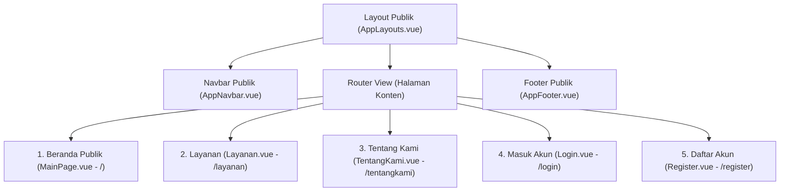

# Dokumentasi Frontend — Landing Page & Autentikasi

## 1. Ikhtisar Halaman Publik

Bagian **Landing Page** dan **Autentikasi** adalah pintu gerbang utama platform **Sinau Matika**. Bagian ini dirancang untuk memperkenalkan visi platform kepada publik (orang tua, calon siswa, guru, dan pengelola sekolah) serta memfasilitasi akses masuk pengguna ke sistem.

Seluruh rute pada bagian ini dikelompokkan dalam file `src/router/public.routes.js` dan dibungkus menggunakan layout publik `AppLayouts.vue` dengan penanda metadata `publicPage: true`.

---

## 2. Struktur Layout & Komponen Publik

### Komponen Tata Letak:
1. **`AppNavbar.vue`**:
   - Menampilkan logo dan identitas **Sinau Matika**.
   - Tautan navigasi: *Beranda*, *Layanan*, dan *Tentang Kami*.
   - Tombol aksi masuk: Tombol *"Masuk"* yang mengarahkan pengunjung ke halaman `/login`.
   - Responsif: Menu navigasi mobile (*hamburger menu*) untuk layar berukuran kecil.
2. **`AppFooter.vue`**:
   - Informasi hak cipta platform.
   - Tautan pintas informasi sekolah, kontak bantuan, dan media sosial.

---

## 3. Fitur Halaman Landing Page

### 3.1. Halaman Beranda (`MainPage.vue` — `/`)
Menjadi etalase utama yang menyampaikan nilai manfaat Sinau Matika:
- **Hero Section**:
  - Judul persuasif: *"Belajar itu Menyenangkan"*.
  - Paragraf pengantar yang menguraikan konsep LMS gamifikasi pendidikan matematika untuk mengukur kemampuan siswa SD secara objektif.
  - **Animasi Lottie Interaktif (`Vue3-Lottie`)**: Menampilkan animasi vektor bertema edukasi yang bergerak dinamis.
  - **Tombol CTA (Call to Action)**: Tombol *"Mulai Sekarang"* yang mengantar pengguna menuju halaman login dan petualangan belajar.
- **Section "Mengapa Memilih Sinau Matika?"**:
  - Menampilkan kartu-kartu keunggulan komparatif platform:
    1. **Belajar dengan Nuansa Game (Gamifikasi)**: Kuis interaktif 4 tipe soal yang tidak membosankan bagi anak.
    2. **Penilaian Cerdas Berbasis AI**: Integrasi kecerdasan buatan Google Gemini untuk memeriksa soal essay matematika secara objektif dan toleran terhadap variasi penulisan.
    3. **Pantau Kemajuan Nyata**: Rekapitulasi nilai otomatis dari kelas 1 sampai kelas 6 untuk memonitor progres jangka panjang siswa.

---

### 3.2. Halaman Layanan (`Layanan.vue` — `/layanan`)
Menjabarkan secara komprehensif kapabilitas platform untuk institusi pendidikan:
- **Paket Fitur Pembelajaran**: Modul materi ajar digital berilustrasi, pembuatan kuis kustom, dan evaluasi berkala.
- **Dukungan Tipe Soal**: Penjelasan mengenai 4 model evaluasi (Pilihan ganda bergambar, menjodohkan kartu gambar, tebak gambar, dan essay teks).
- **Laporan Komprehensif**: Fitur unduh laporan hasil belajar siswa ke format spreadsheet Excel (`.xlsx`) untuk wali murid dan pihak sekolah.

---

### 3.3. Halaman Tentang Kami (`TentangKami.vue` — `/tentangkami`)
- **Latar Belakang & Filosofi**: Penjelasan filosofi nama **"Sinau Matika"** (dari kata *Sinau* yang berarti belajar, dan *Matematika*).
- **Visi & Misi**:
  - Menciptakan iklim pembelajaran matematika yang menyenangkan dan bersahabat bagi generasi muda.
  - Mendukung guru dan tenaga pendidik dengan otomasi koreksi dan analisis nilai yang akurat.
- **Tim Pengembang & Mitra**: Profil pengembang sistem dan dedikasi terhadap kemajuan teknologi pendidikan dasar.

---

## 4. Alur & Fitur Autentikasi

### 4.1. Halaman Masuk Akun (`Login.vue` — `/login`)

Halaman login melayani seluruh tingkatan pengguna (Siswa, Guru, dan Admin) melalui satu antarmuka yang intuitif:
- **Form Kredensial**:
  - Kolom input email/username terdaftar.
  - Kolom input password dilengkapi dengan **tombol intip sandi (Eye / EyeSlash Icon)** untuk kenyamanan pengguna.
  - Opsi *Remember Me* untuk menyimpan preferensi sesi.
- **Animasi Proses Masuk**:
  - Saat tombol *Masuk* ditekan, muncul pop-up animasi **SweetAlert2**:
    > *"Tunggu sebentar ya... Sedang masuk ke petualangan belajar"*
- **Mekanisme Token & Role Redirect**:
  - Setelah verifikasi kredensial berhasil melalui endpoint backend `POST /api/auth/login`, token Bearer Laravel Sanctum dan role pengguna disimpan di `localStorage` serta state Pinia (`authStore.js`).
  - **Sistem Pengalihan Rute Otomatis**:
    * Jika `role === 'siswa'` → dialihkan ke `/dashboard` (Portal Siswa).
    * Jika `role === 'guru'` atau `role === 'admin'` → dialihkan ke `/admin` (Portal Manajemen).
- **Penanganan Kesalahan (*Error Handling*)**:
  - Menampilkan pesan notifikasi SweetAlert2 yang jelas jika kombinasi email atau password salah.

---

### 4.2. Halaman Registrasi Siswa Baru (`Register.vue` — `/register`)

Memfasilitasi pendaftaran mandiri calon siswa:
- **Input Data Registrasi**:
  - Nama lengkap siswa.
  - Alamat email aktif atau akun sekolah.
  - Pembuatan kata sandi dan konfirmasi kata sandi.
  - Pemilihan jenis kelamin dan tanggal lahir.
- **Validasi Formulir**: Pengecekan kesesuaian format email, panjang minimal password, dan konfirmasi password sebelum payload dikirimkan.
- **Pengalihan Sukses**: Setelah akun berhasil didaftarkan, sistem menampilkan notifikasi selamat datang dan langsung mengarahkan siswa ke halaman login untuk masuk pertama kali.

