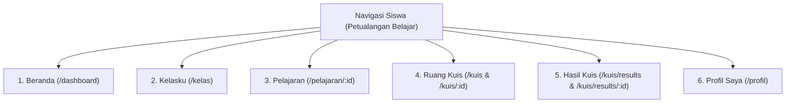
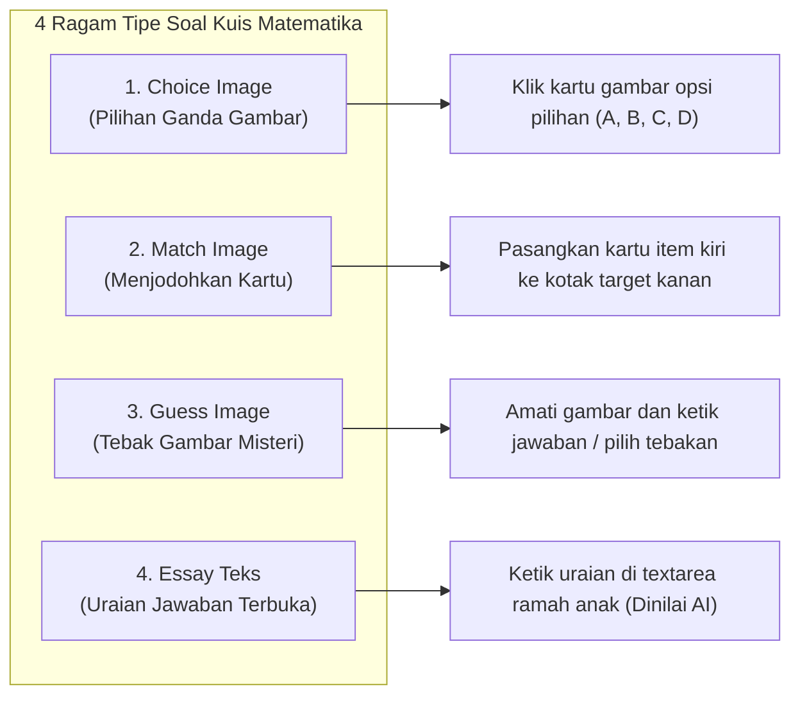

# Dokumentasi Frontend — Modul Siswa

## 1. Konsep Desain: "Petualangan Belajar"

Modul **Siswa** pada **Sinau Matika Frontend** dirancang khusus untuk memenuhi karakteristik psikologis dan visual anak-anak tingkat **Sekolah Dasar (SD)** (Kelas 1 hingga Kelas 6). Antarmuka mengusung konsep **gamifikasi** bertema *"Petualangan Belajar"* yang bertujuan mengubah persepsi matematika dari mata pelajaran yang menakutkan menjadi permainan eksplorasi yang menyenangkan, interaktif, dan penuh penghargaan.

### Ciri Khas Antarmuka Siswa:
1. **Palet Warna Ceria & Hangat**: Didominasi warna ungu lembut (*soft purple*), biru langit, hijau cerah, dan oranye energik.
2. **Ikonografi & Ilustrasi Besar**: Memakai ikon representatif dan animasi ramah anak untuk memudahkan navigasi tanpa harus banyak membaca teks rumit.
3. **Bahasa Ramah Anak**: Teks instruksi menggunakan sapaan bersahabat (contoh: *"Halo Petualang Cilik!"*, *"Tunggu sebentar ya... Sedang masuk ke petualangan belajar"*, *"Tuliskan jawaban essay kamu secara lengkap di sini... ✏️"*).
4. **Dukungan Sentuhan Layar Penuh (Mobile-First)**: Dioptimalkan untuk perangkat tablet dan ponsel pintar yang umum digunakan anak-anak melalui navigasi bawah (*bottom bar*) dan menu samping (*drawer*).

---

## 2. Struktur Menu & Navigasi Siswa

Struktur navigasi portal siswa (`StudentSidebar.vue` dan `StudentMobileNav.vue`) disederhanakan menjadi beberapa menu utama:

---

## 3. Fitur-Fitur Utama Modul Siswa

### 3.1. Beranda Siswa (`Dashboard.vue`)
Pusat petualangan harian siswa yang menyajikan:
- **Kartu Sambutan Personal**: Menyapa nama siswa dengan ilustrasi avatar ceria.
- **Status Kelas Aktif**: Menampilkan rombel kelas saat ini beserta nama guru pengampu yang membimbing.
- **Kuis yang Siap Dikerjakan**: Menampilkan kuis yang sedang dalam status **Aktif** (`is_active = true`) dan berada dalam rentang jadwal pengerjaan.
- **Pemberitahuan Motivasi**: Kalimat penyemangat belajar matematika harian agar anak tetap antusias berlatih.

---

### 3.2. Ruang Kelasku (`KelasPage.vue` & `DetailKelasPage.vue`)
- **Informasi Rombel**: Menampilkan jenjang kelas (misal: *Kelas 4 SD*), tahun ajaran berjalan, dan semester (Gasal/Genap).
- **Profil Guru Pengampu**: Nama dan kontak guru pengampu matematika kelas.
- **Koleksi Modul Pelajaran**: Kartu-kartu modul materi matematika yang tersedia untuk dipelajari pada semester aktif.

---

### 3.3. Modul Materi Matematika (`DetailPelajaranPage.vue`)
- **Tampilan Materi Menarik**: Konten materi ajar matematika dirender secara rapi dengan tipografi ramah anak yang mendukung gambar ilustrasi, teks berwarna, serta rumus matematika sederhana.
- **Peta Petualangan Bab**: Navigasi materi bab sebelumnya dan bab selanjutnya.
- **Akses Cepat Kuis Latihan**: Tombol aksi langsung di akhir materi untuk mengajak siswa menguji pemahamannya melalui kuis latihan interaktif.

---

### 3.4. Pengerjaan Kuis Interaktif (`StartKuisPage.vue`)

Halaman pengerjaan kuis dirancang bebas dari distraksi, nyaman di mata, dan memiliki sistem bantuan navigasi yang lengkap:
- **Indikator Waktu (Timer Hitung Mundur)**: Menampilkan sisa waktu pengerjaan kuis dalam format menit:detik secara jelas.
- **Progress Bar Pengerjaan**: Garis persentase yang terisi secara dinamis seiring siswa menjawab butir soal.
- **Grid Nomor Soal**: Navigasi cepat untuk melompat antar nomor soal, dilengkapi penanda warna (soal yang sudah dijawab vs belum dijawab).

#### Interaktivitas 4 Tipe Soal Matematika:

1. **Pilihan Ganda Bergambar (Choice Image)**:
   - Menampilkan pertanyaan dan 4 kartu gambar opsi pilihan.
   - Siswa cukup mengklik salah satu kartu gambar; kartu terpilih akan memiliki batas warna (*border highlight*) menyala.
2. **Mencocokkan Gambar (Match Image)**:
   - Ditenagai oleh komponen khusus `KanbanMatch.vue`.
   - Siswa disajikan kartu gambar di kolom sebelah kiri dan kotak target di kolom sebelah kanan.
   - Siswa dapat menghubungkan atau memasangkan kartu secara interaktif.
3. **Tebak Gambar (Guess Image)**:
   - Menampilkan gambar visual (seperti bangun geometri, alat ukur matematika, atau jam analog).
   - Siswa mengetikkan jawaban nama benda atau konsep pada kolom isian yang tersedia.
4. **Essay Teks Bebas**:
   - Disediakan textarea luas dengan instruksi bersahabat.
   - Siswa dapat mengetikkan langkah pengerjaan atau kesimpulan hitungan matematika.
   - *Evaluasi Otomatis*: Jawaban essay akan diperiksa kecocokan katanya secara otomatis oleh sistem backend dan dinilai secara toleran menggunakan **Google Gemini AI** jika terdapat sedikit variasi ejaan.

#### Pengiriman Jawaban (Submit Kuis):
- Tombol **"Kirim Jawaban"** memicu dialog konfirmasi interaktif **SweetAlert2**:
  > *"Apakah kamu yakin ingin menyelesaikan kuis ini? Pastikan semua soal sudah kamu periksa ya!"*
- Tombol konfirmasi mengirimkan seluruh *payload* jawaban ke backend secara terpadu.

---

### 3.5. Lembar Hasil Kuis & Penghargaan (`HasilKuisPage.vue` & `GetHasilKuisPage.vue`)

Setelah menyelesaikan kuis, siswa diarahkan ke halaman hasil yang menyenangkan:
- **Animasi Perayaan**: Tampilan animasi Lottie pesta konfeti untuk memberi apresiasi atas usaha belajar anak.
- **Kartu Nilai & Skor Akhir**: Angka perolehan nilai dari rentang 0 s.d. 100 dengan ukuran besar dan jelas.
- **Status Capaian**:
  - **Lulus (Hebat! 🎉)**: Apabila nilai mencapai atau melampaui KKM.
  - **Perlu Belajar Lagi (Tetap Semangat! 💪)**: Apabila nilai belum memenuhi KKM, disertai ajakan ramah untuk mempelajari kembali modul materi.
- **Ringkasan Pengerjaan**: Rincian jumlah soal yang dijawab dengan benar, jumlah salah, dan durasi pengerjaan kuis.
- **Kebijakan Skor Terbaik (*Best Score Policy*)**:
  - Siswa dapat melihat daftar seluruh kuis yang pernah dikerjakan pada menu `Hasil Kuis (/kuis/results)`.
  - Jika siswa mengerjakan kuis yang sama lebih dari satu kali, sistem secara otomatis menyimpan dan menampilkan nilai tertinggi yang berhasil diraih anak.

---

### 3.6. Profil Siswa (`ProfilePage.vue`)
- **Data Diri Siswa**: Menampilkan nama lengkap siswa, NISN/email, dan kelas tempat siswa bernaung.
- **Ganti Kata Sandi**: Formulir ganti kata sandi mandiri dengan panduan sederhana jika siswa ingin mengubah password.
- **Tombol Keluar (*Logout*)**: Dialog konfirmasi sebelum keluar untuk memastikan sesi akun tetap aman saat menggunakan komputer sekolah bersama.

